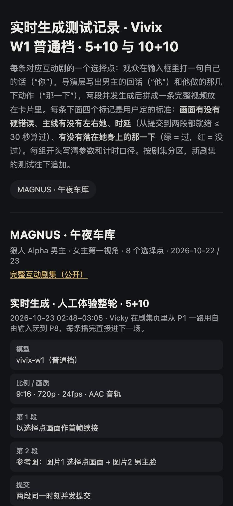

# 实时生成测试记录

互动剧“观众自由输入 → 实时生成男主回应视频”的测试记录板，按剧集分区，每条一张卡片：完整视频、她说的话、他的回话、那一下、各段计时、四个标记（画面硬错误 / 有没有左右她 / 时延 / 那一下有没有落在她身上）。

在线查看：https://lyx1265897416-lab.github.io/realtime-drama-test-log/

## 预览

在线体验：https://lyx1265897416-lab.github.io/realtime-drama-test-log/

| 首页 | 播放中 |
|:---:|:---:|
|  |  |

关键画面：

## 结构

- `index.html`：页面，只负责渲染，不用改。
- `data.js`：全部数据，`window.LOG = {updated, dramas: [...]}`。
  - 每个剧集：`{id, title, sub, links, groups}`
  - 每组：`{title, when, note, params: [[名, 值]], summary: [[名, 值]], cards}`
  - 每条卡片：`{n, label, video, poster, her, he, he_zh, beat, rule?, stats: [[名, 值]], marks: [[1/0, 标记名, 说明] × 4], job}`
- `v/`：每条的完整视频（两段拼成一条，720p）和封面。
- `film/`：每个剧集的完整成片（预设剧情 + 实时片段接在一起），附外挂中英字幕 `.vtt`；剧集对象里用 `films` 字段列出，`chapters` 给选择点跳转。

## 追加新剧集

往 `data.js` 的 `dramas` 数组末尾加一个剧集对象，视频放进 `v/`，命名 `<剧集id>-<条目id>.mp4`。当前数据由 `output/vivix-tests-20261022/build_log.py` 生成。
